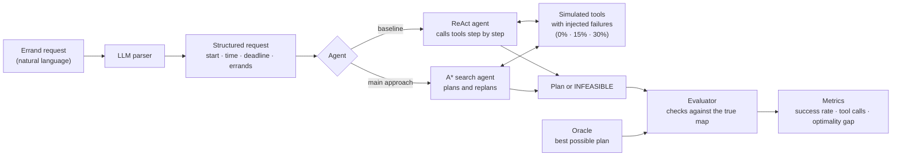

# Search-Guided Agents for Multi-Errand Planning Under Tool Failures

[](https://github.com/mariajose-ai/errand-agents/actions/workflows/tests.yml)

An independent research project by Maria Jose Rios.

When an AI assistant's tools fail (an opening-hours lookup times out, or a response
comes back incomplete), can it still plan a workable route for several errands?
This project compares an agent that plans with A* search and replans after errors
against a ReAct-style agent that calls tools step by step.

**Research question:** Under controlled tool-call failures, does an A* search-guided
agent produce more feasible errand plans than a sequential ReAct agent, and how many
extra tool calls does that cost?

Everything runs offline against a frozen map and simulated tools, so experiments are
repeatable.

## How it works



## Status

Early setup. See [docs/LOG.md](docs/LOG.md) for progress.

## Setup

```bash
python -m venv .venv
.venv\Scripts\activate
pip install -e ".[dev]"
pytest
```

## Layout

```
src/errand_agents/   package code
tests/               tests
data/                map data and scenarios (see data/README.md)
docs/                proposal, project log, design decisions
```
